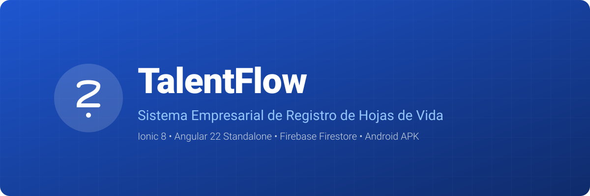
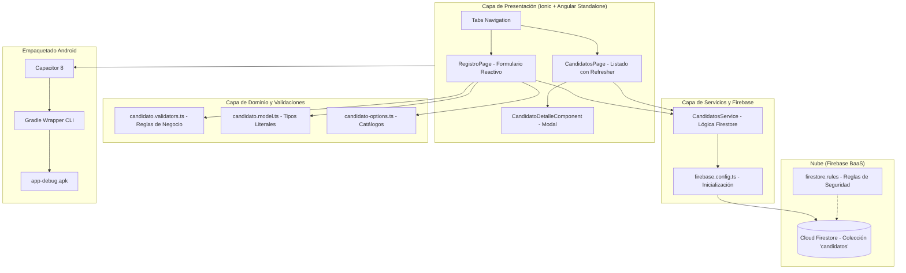

<p align="center">
  
</p>

# 🎯 TalentFlow — Registro Empresarial de Hojas de Vida

> *Aplicación móvil empresarial desarrollada con **Ionic**, **Angular Standalone**, **Firebase Cloud Firestore** y empaquetada como APK nativo mediante **Capacitor**.*

<p align="center">
  
  
  
  
  
  
  
</p>

---

## 📑 Tabla de Contenidos

1. [📖 Descripción del Proyecto](#-descripción-del-proyecto)
2. [✨ Características Principales](#-características-principales)
3. [🏗️ Arquitectura del Sistema](#-arquitectura-del-sistema)
4. [🛠️ Tecnologías y Componentes Ionic](#-tecnologías-y-componentes-ionic)
5. [🗂️ Modelo de Datos](#-modelo-de-datos)
6. [🚀 Instalación y Ejecución Local](#-instalación-y-ejecución-local)
7. [📱 Generación del APK por CMD](#-generación-del-apk-por-cmd)
8. [🔐 Seguridad y Reglas de Firestore](#-seguridad-y-reglas-de-firestore)
9. [🧪 Matriz de Pruebas y Validación](#-matriz-de-pruebas-y-validación)
10. [📸 Evidencias](#-evidencias)
11. [👥 Integrantes y Distribución del Trabajo](#-integrantes-y-distribución-del-trabajo)
12. [📄 Licencia](#-licencia)

---

## 📖 Descripción del Proyecto

La empresa ficticia **TalentFlow S. A.** experimentaba dificultades para organizar los perfiles de los candidatos que postulaban por correo electrónico. Para solucionar este problema, el equipo de Talento Humano requería una **aplicación móvil moderna de registro de postulantes** que capture información estructurada, valide la integridad de los datos en tiempo real y almacene las hojas de vida en la nube para su consulta inmediata.

Este proyecto implementa un **MVP móvil de alta fidelidad** desarrollado con **Ionic 9**, **Angular 22 Standalone Components** y **Firebase Cloud Firestore**, con empaquetado nativo para Android mediante **Capacitor 8**.

---

## ✨ Características Principales

* 📝 **Formulario Segmentado por Bloques:** Formulario reactivo de 13 campos estructurado en 3 tarjetas ergonómicas (`Datos Personales`, `Perfil Profesional`, `Disponibilidad y Resumen`) para evitar la fatiga móvil.
* 🛡️ **Validaciones Defensivas en Doble Capa:** Validación síncrona en cliente con mensajes de error contextuales y validación estricta en servidor mediante reglas de seguridad de Firestore.
* ☁️ **Persistencia en Tiempo Real:** Integración directa con Cloud Firestore (`addDoc`, `getDocs`, `serverTimestamp`), asegurando atributos indexables e inmutabilidad temporal.
* 🔎 **Consulta y Detalle Completo:** Listado visual con pull-to-refresh (`ion-refresher`) y visualización de la totalidad de datos del candidato mediante un modal emergente (`ion-modal`).
* 🎨 **Diseño Inclusivo y Accesible:** Paleta con contraste validado WCAG 2.2 AA, soporte de modo oscuro y componentes táctiles adaptados a pantallas móviles.
* 📱 **Compilación Nativa por CMD:** Generación automática del APK de depuración sin requerir la interfaz de Android Studio.

---

## 🏗️ Arquitectura del Sistema

El proyecto sigue una arquitectura desacoplada y orientada a servicios, donde la capa de presentación nunca accede directamente a la base de datos:



### Estructura de Directorios

```text
TalentFlow/
├── android/                    # Proyecto nativo generado por Capacitor
│   └── app/build/outputs/apk/  # Salida del APK compilado
├── docs/                       # Documentación, banners y evidencias
│   ├── assets/
│   └── evidencias/
├── src/
│   ├── app/
│   │   ├── core/
│   │   │   ├── firebase/       # Inicialización modular de Firebase
│   │   │   ├── models/         # Contrato tipado Candidato y catálogos
│   │   │   └── validators/     # Validadores síncronos y testeables
│   │   ├── features/
│   │   │   ├── registro/       # Vista y formulario de registro
│   │   │   └── candidatos/     # Vista de listado y modal de detalle
│   │   ├── services/           # CandidatosService (acceso Firestore)
│   │   └── tabs/               # Shell de navegación por pestañas
│   ├── environments/           # Configuración de entornos y Firebase
│   └── theme/                  # Tokens de diseño y variables Ionic
├── capacitor.config.ts         # Configuración de Capacitor
├── firestore.rules             # Reglas de seguridad de Firestore
├── firebase.json               # Configuración de emuladores
└── package.json                # Dependencias y scripts de build
```

---

## 🛠️ Tecnologías y Componentes Ionic

### Stack Tecnológico
* **Frontend:** Ionic Framework 9, Angular 22 (Standalone Components), TypeScript 5.8, SCSS.
* **Backend BaaS:** Firebase Cloud Firestore SDK Modular (`firebase/firestore`).
* **Testing:** Vitest 5.1 (27 pruebas unitarias de Angular + 10 pruebas de reglas de Firestore en Emulador real), Playwright 1.65 (E2E Testing y captura automatizada de evidencias). Total: **38 pruebas aprobadas**.
* **Empaquetado Móvil:** Capacitor 8, Android SDK Platform 36 (targetSdk 36, minSdk 24), Gradle Wrapper 8.14.3.

### Inventario de Componentes Ionic Utilizados (13 tipos)

| Componente | Sección / Pantalla | Propósito |
|---|---|---|
| `ion-input` | Registro | Captura de nombres, correo, teléfono, fechas (date picker), experiencia y salario. |
| `ion-select` / `ion-select-option` | Registro | Selección del cargo al que postula (4 opciones). |
| `ion-radio-group` / `ion-radio` | Registro | Selección única de nivel académico. |
| `ion-segment` / `ion-segment-button` | Registro | Selector táctil de modalidad de trabajo (Presencial/Híbrida/Remota). |
| `ion-checkbox` | Registro | Selección múltiple de habilidades técnicas y consentimiento. |
| `ion-textarea` | Registro | Redacción del resumen profesional (mínimo 30 caracteres). |
| `ion-button` | Registro / Listado / Detalle | Acciones principales de envío, limpieza, cierre y reintento. |
| `ion-card` | Registro / Listado / Detalle | Agrupación visual en tarjetas de contenido. |
| `ion-modal` | Candidatos | Presentación del detalle completo del candidato sin recargar pantalla. |
| `ion-refresher` | Candidatos | Gesto táctil pull-to-refresh para recargar desde Firestore. |
| `ion-chip` / `ion-badge` | Listado / Detalle | Etiquetas visuales de habilidades, modalidad y contadores. |
| `ion-skeleton-text` | Candidatos | Estado de carga esquelético antes de recibir los datos. |
| `ion-spinner` | Registro / Candidatos | Indicadores circulares de procesamiento durante guardado. |

---

## 🗂️ Modelo de Datos

Los candidatos se almacenan como documentos individuales en la colección `candidatos` de Firestore. Cada atributo se guarda de manera independiente e indexable:

### Interfaz TypeScript (`candidato.model.ts`)

```typescript
export type Cargo = 'Desarrollador móvil' | 'Analista de datos' | 'Diseñador UX/UI' | 'Soporte TI';
export type NivelAcademico = 'Bachillerato' | 'Tecnología' | 'Tercer nivel' | 'Posgrado';
export type Modalidad = 'Presencial' | 'Híbrida' | 'Remota';
export type Habilidad = 'Angular' | 'Ionic' | 'JavaScript' | 'Python' | 'SQL' | 'Git' | 'Firebase';

export interface Candidato {
  id?: string;
  nombres: string;
  correo: string;
  telefono: string;
  fechaNacimiento: string;     // ISO YYYY-MM-DD (evita desvíos UTC)
  cargo: Cargo;
  nivelAcademico: NivelAcademico;
  experienciaAnios: number;
  modalidad: Modalidad;
  habilidades: Habilidad[];
  fechaDisponibilidad: string; // ISO YYYY-MM-DD
  aspiracionSalarial: number;  // USD
  resumen: string;
  consentimiento: boolean;
  creadoEn?: Timestamp | string | null; // serverTimestamp() de Firestore
}
```

### Documento Firestore de Ejemplo

```json
{
  "nombres": "Ana María Pérez",
  "correo": "ana.perez@talentflow.test",
  "telefono": "0991234567",
  "fechaNacimiento": "1998-06-20",
  "cargo": "Desarrollador móvil",
  "nivelAcademico": "Tercer nivel",
  "experienciaAnios": 3,
  "modalidad": "Híbrida",
  "habilidades": ["Ionic", "Angular", "Firebase", "Git"],
  "fechaDisponibilidad": "2026-12-01",
  "aspiracionSalarial": 1400,
  "resumen": "Desarrolladora frontend y móvil con experiencia en arquitecturas reactivas y aplicaciones multiplataforma.",
  "consentimiento": true,
  "creadoEn": "11 de noviembre de 2026, 14:45:00 UTC-5"
}
```

---

## 🚀 Instalación y Ejecución Local

### Prerrequisitos
* **Node.js:** v22 LTS o superior (`node -v`)
* **npm:** v10+ (`npm -v`)
* **Ionic CLI:** (`npm install -g @ionic/cli`)

### Pasos de Instalación

1. **Clonar el repositorio:**
   ```bash
   git clone <URL_DEL_REPOSITORIO>
   cd TalentFlow
   ```

2. **Instalar dependencias:**
   ```bash
   npm install
   ```

3. **Configurar credenciales de Firebase:**
   Copia el archivo de plantilla `.env.example` o configura `src/environments/environment.ts`:
   ```typescript
   export const environment = {
     production: false,
     firebase: {
       apiKey: "TU_API_KEY",
       authDomain: "tu-proyecto.firebaseapp.com",
       projectId: "tu-proyecto",
       storageBucket: "tu-proyecto.appspot.com",
       messagingSenderId: "123456789012",
       appId: "1:123456789012:web:abcdef123456"
     }
   };
   ```

4. **Ejecutar en modo de desarrollo:**
   ```bash
   ionic serve
   ```
   *La aplicación estará disponible en `http://localhost:8100/`.*

5. **Ejecutar pruebas unitarias, de reglas, E2E y linter:**
   ```bash
   npm run test:unit       # 27 pruebas unitarias con Vitest (servicios, componentes, validadores)
   npm run test:rules      # 10 pruebas de seguridad ejecutadas en el Emulador de Firestore
   npm run test:e2e        # Pruebas End-to-End con Playwright (Pixel 7 emulado)
   npm test                # Suite completa: 38 pruebas en total en verde
   npm run eslint          # Verificación estricta de estilo y tipos
   npm audit --omit=dev    # Auditoría de dependencias (0 vulnerabilidades)
   ```

> 🔒 **Nota sobre Credenciales y Despliegue:**
> Las credenciales de Firebase incluidas en `environment.ts` y `.env.example` corresponden al proyecto del taller académico (`talentflowepn`). Para entornos de producción, la API key debe restringirse en Google Cloud Console mediante huella digital SHA-256 del certificado Android y nombre del paquete (`io.ionic.starter` / `com.talentflow.app`), además de habilitar Firebase App Check y utilizar las reglas de [`firestore.prod.rules`](firestore.prod.rules).

---

## 📱 Generación del APK por CMD

El APK de Android se genera directamente desde la línea de comandos (CMD / PowerShell) utilizando **Capacitor 8** y el **Gradle Wrapper**, sin necesidad de compilar desde la interfaz de Android Studio.

### Configuración del Entorno Android en Windows

```bat
:: En CMD:
set JAVA_HOME=C:\Program Files\Android\Android Studio\jbr
set ANDROID_HOME=C:\Android\Sdk
set PATH=%PATH%;%ANDROID_HOME%\platform-tools

:: O en PowerShell:
$env:JAVA_HOME = "C:\Program Files\Android\Android Studio\jbr"
$env:ANDROID_HOME = "C:\Android\Sdk"
$env:PATH += ";$env:ANDROID_HOME\platform-tools"
```

### Comando Rápido de Compilación

Hemos configurado un script automatizado en `package.json`:

```bash
npm run apk:debug
```

*(Equivale a ejecutar: `npm run build && npx cap sync android && cd android && .\gradlew.bat assembleDebug`)*

### Ubicación del APK Generado

```text
android\app\build\outputs\apk\debug\app-debug.apk
```

### Instalación en Dispositivo o Emulador vía ADB

```bash
adb devices
adb install -r android\app\build\outputs\apk\debug\app-debug.apk
```

---

## 🔐 Seguridad y Reglas de Firestore

### 1. Reglas Utilizadas para la Demostración (`firestore.rules`)

Para el entorno del taller académico se diseñó una regla que permite lectura y creación pública pero **con validación estricta de esquema y tipos de datos en el servidor**, bloqueando cualquier eliminación o modificación destructiva:

```javascript
rules_version = '2';
service cloud.firestore {
  match /databases/{database}/documents {
    function esTextoNoVacio(v, min, max) {
      return v is string && v.size() >= min && v.size() <= max;
    }

    function candidatoValido(d) {
      return d.keys().hasOnly([
          'nombres', 'correo', 'telefono', 'fechaNacimiento', 'cargo',
          'nivelAcademico', 'experienciaAnios', 'modalidad', 'habilidades',
          'fechaDisponibilidad', 'aspiracionSalarial', 'resumen',
          'consentimiento', 'creadoEn'
        ]) &&
        esTextoNoVacio(d.nombres, 3, 100) &&
        d.correo is string &&
        d.correo.matches('^[^@\\s]+@[^@\\s]+\\.[a-zA-Z]{2,}$') &&
        d.telefono is string &&
        d.telefono.matches('^[+]?[0-9][0-9\\s-]{6,19}$') &&
        d.fechaNacimiento is string &&
        d.fechaNacimiento.matches('^\\d{4}-\\d{2}-\\d{2}$') &&
        d.cargo in ['Desarrollador móvil', 'Analista de datos', 'Diseñador UX/UI', 'Soporte TI'] &&
        d.nivelAcademico in ['Bachillerato', 'Tecnología', 'Tercer nivel', 'Posgrado'] &&
        d.experienciaAnios is int && d.experienciaAnios >= 0 && d.experienciaAnios <= 50 &&
        d.modalidad in ['Presencial', 'Híbrida', 'Remota'] &&
        d.habilidades is list && d.habilidades.size() >= 1 && d.habilidades.size() <= 7 &&
        d.habilidades.hasOnly(['Angular', 'Ionic', 'JavaScript', 'Python', 'SQL', 'Git', 'Firebase']) &&
        d.fechaDisponibilidad is string &&
        d.fechaDisponibilidad.matches('^\\d{4}-\\d{2}-\\d{2}$') &&
        d.aspiracionSalarial is number && d.aspiracionSalarial > 0 &&
        esTextoNoVacio(d.resumen, 30, 600) &&
        d.consentimiento == true &&
        d.creadoEn == request.time;
    }

    match /candidatos/{id} {
      allow read: if true;                 // Solo para demostración académica
      allow create: if candidatoValido(request.resource.data);
      allow update, delete: if false;     // Protegido contra borrado y manipulación
    }
  }
}
```

> Las reglas completas para entornos productivos con roles de autenticación y App Check se encuentran versionadas en [`firestore.prod.rules`](firestore.prod.rules).

### 2. Por qué estas reglas NO son aptas para producción
* **Lectura abierta:** Cualquier cliente con la configuración de Firebase podría listar todas las hojas de vida almacenadas.
* **Ausencia de autenticación:** No se verifica la identidad del remitente.

### 3. Reglas Recomendadas para Producción
En un despliegue corporativo real, la lectura debe restringirse a usuarios con el rol verificado de reclutador (`request.auth.token.role == 'reclutador'`), y la creación debe asegurarse mediante **Firebase App Check** (Play Integrity / reCAPTCHA) y **Cloud Functions**:

```javascript
match /candidatos/{id} {
  allow read: if request.auth != null && request.auth.token.role == 'reclutador';
  allow create: if request.auth != null && candidatoValido(request.resource.data);
  allow update, delete: if false;
}
```

---

## 🧪 Matriz de Pruebas y Validación

Se ejecutaron pruebas automatizadas y funcionales manuales cubriendo casos exitosos y de validación fallida:

| # | Caso de Prueba | Datos de Entrada | Resultado Esperado | Resultado Obtenido | Estado |
|---|---|---|---|---|:---:|
| **CP-01** | Registro Válvula Completo | Ana Pérez, ana@test.com, 0991234567, 3 años exp, Híbrida, 3 habilidades, resumen > 30 chars, consentimiento: true | Formulario válido, guardado en Firestore, toast verde y reset. | Guardado exitoso, ID generado en Firestore. | ✅ PASS |
| **CP-02** | Registro Remoto sin Exp | Luis Torres, 0 años de experiencia, Modalidad Remota, 1 habilidad, consentimiento: true | Válido, guarda experiencia 0 y modalidad Remota. | Documento registrado con `experienciaAnios: 0`. | ✅ PASS |
| **CP-03** | Múltiples Habilidades | Sofía Gómez, 5 habilidades seleccionadas (Ionic, Angular, Python, SQL, Git) | Arreglo de 5 strings en Firestore. | Campo `habilidades` guardado con 5 elementos. | ✅ PASS |
| **CP-04** | Candidato Posgrado | Jorge Dávila, Posgrado, Soporte TI, aspiración $2500 USD | Registro con nivel académico y salario correcto. | Datos persistidos fielmente. | ✅ PASS |
| **CP-05** | Modalidad Presencial | Elena Castro, Diseñador UX/UI, Presencial, 2 años exp | Registro correcto con modalidad Presencial. | Persistencia y visualización confirmada. | ✅ PASS |
| **CP-06** | ❌ Correo Inválido | Correo: `correo-sin-arroba` | Error visual inline, botón guardar deshabilitado. | Bloqueado en cliente; no se invoca Firebase. | ✅ PASS |
| **CP-07** | ❌ Sin Consentimiento | Formulario completo pero checkbox de consentimiento desmarcado | Formulario inválido, botón deshabilitado. | Envío impedido por validador `requiredTrue`. | ✅ PASS |
| **CP-08** | ❌ Fecha Nacimiento Futura | Fecha seleccionada: `2099-12-31` | Error `La fecha de nacimiento no puede ser futura`. | Rechazado por validador personalizado. | ✅ PASS |
| **CP-09** | ❌ Resumen muy Corto | Resumen: `Hola soy desarrollador` (22 caracteres) | Error inline indicando mínimo 30 caracteres. | Bloqueado hasta completar longitud requerida. | ✅ PASS |

---

## 📸 Evidencias

Las capturas de pantalla del prototipo y de la consola de Firebase Firestore se encuentran organizadas en la carpeta [`docs/evidencias/`](docs/evidencias/):

| Evidencia | Descripción | Archivo |
|---|---|---|
| **01 - Formulario de Registro** | Captura del formulario organizado en 3 bloques visuales con componentes Ionic. | `docs/evidencias/01-formulario-registro.png` |
| **02 - Validaciones de Error** | Mensajes en rojo al ingresar campos erróneos (correo, fechas, resumen corto). | `docs/evidencias/02-validaciones-error.png` |
| **03 - Listado de Candidatos** | Vista de tarjetas con candidatos recuperados desde Firestore y pull-to-refresh. | `docs/evidencias/03-listado-candidatos.png` |
| **04 - Modal de Detalle** | Pantalla modal con la totalidad de los datos estructurados del postulante. | `docs/evidencias/04-detalle-modal.png` |
| **05 - Consola de Firebase** | Documentos creados en la colección `candidatos` con sus atributos y timestamp. | `docs/evidencias/05-firebase-firestore.png` |
| **06 - Compilación del APK** | Terminal CMD mostrando la ejecución exitosa de `assembleDebug` y el APK generado. | `docs/evidencias/06-compilacion-apk.png` |

---

## 👥 Integrantes y Distribución del Trabajo

* **Estudiante 1 / Integrante:** [Nombres y Apellidos Completos] — Arquitectura frontend, componentes Ionic y diseño UI/UX.
* **Estudiante 2 / Integrante:** [Nombres y Apellidos Completos] — Integración con Firebase Firestore, reglas de seguridad y compilación del APK.

---

## 📄 Licencia

Este proyecto fue desarrollado con fines exclusivamente académicos para el taller práctico de la asignatura **Desarrollo de Aplicaciones Móviles**. Distribuido bajo la licencia [MIT](LICENSE).
