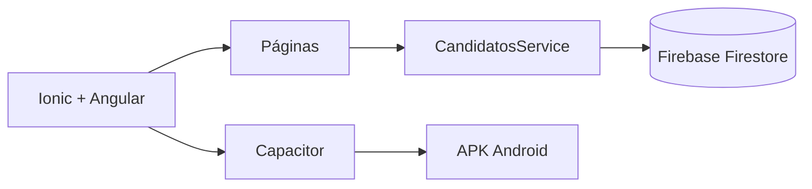

# Plan de Implementación — TalentFlow

**Proyecto:** Registro empresarial de hojas de vida con Ionic + Angular Standalone + Firebase Firestore
**Fecha:** 2026-11-11
**Fuente:** [jzaldumbide/ionic-formulario-firebase](https://github.com/jzaldumbide/ionic-formulario-firebase)
**Referencia técnica:** [jzaldumbide/registro-estudiantes-ejemplo](https://github.com/jzaldumbide/registro-estudiantes-ejemplo)
**Estado:** Propuesto — pendiente de aprobación antes de escribir código
**Duración estimada:** 3 h (alcance mínimo del taller) / 8–14 h con endurecimiento, pruebas, README completo y APK

---

## 1. Resumen ejecutivo

Construir un MVP móvil llamado **TalentFlow** que permita a Talento Humano registrar, validar, almacenar y consultar perfiles de candidatos. La app tendrá dos vistas diferenciadas (Registrar candidato y Consultar candidatos), usará componentes Ionic variados, validación en dos capas y persistencia en la colección `candidatos` de Cloud Firestore.

El plan integra explícitamente:

- **Diseño:** sistema de tokens, mobile-first, estados de UI, accesibilidad WCAG 2.2 AA y motion funcional.
- **Seguridad:** reglas Firestore versionadas y probadas, gestión de secretos, minimización de datos, privacidad y mapa OWASP Mobile.
- **Calidad:** TDD, pruebas de reglas con emulador, code review, dependency audit, documentación sincronizada y README evaluable.
- **Empaquetado:** APK Android generado por CMD con Capacitor y el Gradle Wrapper.
- **Ejecución:** flujo de trabajo con los skills y agentes locales ya revisados (`.agent/skills`, `.agent/agents`, `.agent/rules`).

---

## 2. Contexto y problema

TalentFlow S. A. recibe hojas de vida por correo y no logra organizarlas. El equipo de Talento Humano necesita capturar información estructurada de postulantes y consultarla después. El repositorio base solo contiene el enunciado del taller; por tanto, este plan parte de cero y usa el proyecto de estudiantes únicamente como referencia de conexión con Firestore.

**Problema a resolver:** eliminar el registro disperso por correo mediante un formulario digital validado y un listado consultable en la nube.

---

## 3. Objetivo y criterios de éxito

### Objetivo general

Entregar un prototipo funcional que demuestre dominio de formularios Ionic, validación, persistencia y consulta en Firestore, con calidad y seguridad documentadas.

### Criterios de éxito medibles

1. El formulario contiene todos los campos obligatorios y no permite guardar registros inválidos.
2. Se usan al menos 8 tipos de componentes Ionic, incluidos los 8 obligatorios.
3. Se guardan al menos 5 candidatos ficticios y persisten tras recargar la app.
4. El listado y el detalle leen datos reales desde Firestore.
5. Se muestran estados de carga, éxito, error y vacío.
6. Las reglas Firestore están versionadas, probadas en emulador y documentadas como no aptas para producción.
7. `npm test`, `npm run build`, `npm run lint` y `npm audit` pasan sin errores críticos.
8. El README permite reproducir el proyecto desde un clon limpio y cubre los 11 puntos del entregable.
9. Contraste WCAG AA en tokens de texto y componentes; navegación por teclado y lectores de pantalla verificada en los flujos principales.

---

## 4. Alcance

### 4.1 Dentro del alcance (MVP obligatorio)

- Vista **Registrar candidato** con formulario completo por secciones.
- Vista **Consultar candidatos** con listado resumido y detalle completo.
- Validación de campos antes de enviar a Firebase.
- Guardado en `candidatos` con `serverTimestamp()` en `creadoEn`.
- Estados de carga, éxito, error y vacío.
- Limpieza del formulario tras guardado exitoso.
- Componentes Ionic requeridos y complementarios.
- Reglas Firestore de demostración, versionadas y probadas.
- README con arquitectura, modelo de datos, instalación, evidencias, pruebas y seguridad.
- Pruebas unitarias y de reglas; matriz manual de 5 casos válidos y 2 inválidos.
- APK de depuración generado por línea de comandos (CMD) con Capacitor + Gradle.

### 4.2 Fuera del alcance (MVP)

- Autenticación real de usuarios.
- Carga de archivos PDF.
- Edición y eliminación de candidatos.
- Datos personales reales.
- Multi-empresa / multi-tenant.
- Analítica, notificaciones push y pagos.
- Despliegue a producción con reglas abiertas.

> Estas funciones quedan como backlog opcional y no deben retrasar el MVP.

### 4.3 Supuestos explícitos (confirmar antes de ejecutar)

- **Stack:** Ionic 8 + Angular 20 Standalone + Firebase Modular SDK (Firestore).
- **Entorno:** Node.js 22 LTS y npm.
- **SDK Firebase:** se usará el SDK modular directo, igual que el proyecto de referencia; si el equipo prefiere `@angular/fire`, se decide en T2 sin cambiar el resto del plan.
- **Base de datos:** Firestore en modo nativo, colección `candidatos`.
- **UI:** español, mobile-first, modo claro y oscuro.
- **Datos:** exclusivamente ficticios.
- **Equipo:** individual o pareja; el plan asume una persona ejecutora y revisiones cruzadas si son dos.
- **Tiempo:** el MVP del taller cabe en 3 h; las fases de endurecimiento son adicionales.
- **Android:** JDK 21 + Android SDK (Platform 35, Build Tools y Platform Tools) configurados para compilar el APK por CMD.

---

## 5. Stack y decisiones técnicas

| Área | Decisión | Gesto / justificación |
|------|----------|-----------------------|
| Framework | Angular 20 Standalone | Requisito del taller; sin NgModules para menor complejidad |
| UI | Ionic 8 | Componentes móviles requeridos y integración con Angular |
| Estado | Signals + Reactive Forms | Reactividad simple y formularios tipados/testeables |
| Persistencia | Firebase Modular SDK + Firestore | `addDoc`, `getDocs`, `serverTimestamp`; alineado a la referencia |
| Fechas | Strings ISO `YYYY-MM-DD` para fechas de calendario | Evita corrimientos de zona horaria; `creadoEn` sí usa `Timestamp` |
| Validación | Angular Validators + validadores custom + reglas Firestore | Defensa en profundidad |
| Pruebas unitarias | Jasmine + Karma (`ng test`) | Stack por defecto de Angular; evita riesgo de migración |
| Pruebas de reglas | `@firebase/rules-unit-testing` + Firebase Emulator | Verifica seguridad sin tocar producción |
| E2E (opcional) | Playwright | Flujo crítico de registro y consulta |
| Estilos | CSS custom properties (tokens) + variables Ionic | Theming consistente y contraste verificable |
| Empaquetado Android | Capacitor 7 + Gradle Wrapper | APK generado por CMD, sin depender de la UI de Android Studio |
| CI/CD (opcional) | GitHub Actions: lint → test → build → audit | Calidad reproducible |

### Decisión sobre secretos y configuración

La configuración web de Firebase (`apiKey`, `authDomain`, `projectId`, etc.) **no es un secreto**: se compila en el bundle. La seguridad real depende de las reglas Firestore, App Check y la restricción de la API key por dominio/app. Lo que **nunca** se versiona es:

- Cuentas de servicio / claves privadas del Admin SDK.
- Tokens de CI o `.env` reales.
- Archivos `serviceAccount*.json`.
- Credenciales administrativas de Firebase.

Se versionan `environment.example.ts` y `.env.example` con marcadores y comentarios; los valores reales viven en el entorno local o en secretos de CI.

---

## 6. Arquitectura de la aplicación

### 6.1 Estructura de carpetas propuesta

```text
src/
  app/
    core/
      firebase/
        firebase.config.ts          # inicialización desde environment
      models/
        candidato.model.ts          # interfaz + tipos literales
        candidato-options.ts        # cargos, niveles, habilidades
      validators/
        fecha.validators.ts         # no futura / no anterior a hoy
        telefono.validator.ts
    features/
      registro/
        registro.page.ts|html|scss
        registro.page.spec.ts
      candidatos/
        candidatos.page.ts|html|scss
        candidato-detalle/
          candidato-detalle.component.ts|html|scss
        candidatos.page.spec.ts
    services/
      candidatos.service.ts
      candidatos.service.spec.ts
    shared/
      components/
        estado-vacio/
        campo-error/
    app.routes.ts
    app.component.ts
  environments/
    environment.example.ts
  theme/
    tokens.scss
    variables.scss
firestore.rules
firebase.json
```

### 6.2 Capas y responsabilidades

- **Páginas/componentes:** presentación, Reactive Forms, estados de UI. No acceden directamente a Firestore.
- **Servicio `CandidatosService`:** encapsula `addDoc`, `getDocs`/`onSnapshot`, mapeo de documentos, `serverTimestamp()` y traducción de errores.
- **Modelo:** contrato tipado de `Candidato` y catálogos de opciones.
- **Validadores:** lógica reutilizable y testeable, sin dependencia de UI.
- **Core Firebase:** una sola inicialización; sin configuración dispersa.

### 6.3 Flujo de datos

```text
Formulario (Reactive Forms)
  → validación local (síncrona + custom)
  → CandidatosService.crear()
      → addDoc(candidatos, { ...datos, creadoEn: serverTimestamp() })
      → reglas Firestore validan de nuevo
  → toast de éxito + reset del formulario
  → navegación a Candidatos
      → getDocs / onSnapshot
      → mapeo a Candidato[]
      → lista → detalle (modal)
```

### 6.4 Navegación

- `ion-tabs` con dos pestañas: **Registrar** y **Candidatos**.
- Ruta de detalle mediante `ion-modal` (no requiere ruta hija).
- Botón de refresco (`ion-refresher`) en el listado.

---

## 7. Modelo de datos

### 7.1 Interfaz TypeScript

```ts
export type Cargo = 'Desarrollador móvil' | 'Analista de datos' | 'Diseñador UX/UI' | 'Soporte TI';
export type NivelAcademico = 'Bachillerato' | 'Tecnología' | 'Tercer nivel' | 'Posgrado';
export type Modalidad = 'Presencial' | 'Híbrida' | 'Remota';
export type Habilidad = 'Angular' | 'Ionic' | 'JavaScript' | 'Python' | 'SQL' | 'Git' | 'Firebase';

export interface Candidato {
  id?: string;
  nombres: string;
  correo: string;
  telefono: string;
  fechaNacimiento: string;        // ISO YYYY-MM-DD
  cargo: Cargo;
  nivelAcademico: NivelAcademico;
  experienciaAnios: number;
  modalidad: Modalidad;
  habilidades: Habilidad[];
  fechaDisponibilidad: string;    // ISO YYYY-MM-DD
  aspiracionSalarial: number;     // USD
  resumen: string;
  consentimiento: boolean;
  creadoEn?: Timestamp;           // serverTimestamp()
}
```

### 7.2 Documento Firestore de ejemplo

```json
{
  "nombres": "Ana Pérez",
  "correo": "ana.ejemplo@correo.test",
  "telefono": "0990000000",
  "fechaNacimiento": "2000-04-15",
  "cargo": "Desarrollador móvil",
  "nivelAcademico": "Tercer nivel",
  "experienciaAnios": 3,
  "modalidad": "Híbrida",
  "habilidades": ["Ionic", "Angular", "Git"],
  "fechaDisponibilidad": "2026-12-01",
  "aspiracionSalarial": 1200,
  "resumen": "Desarrolladora de aplicaciones móviles con experiencia en interfaces y servicios web.",
  "consentimiento": true,
  "creadoEn": "<Timestamp del servidor>"
}
```

### 7.3 Reglas de modelado

- Cada campo se guarda como atributo consultable; nunca como un JSON de texto.
- `creadoEn` se genera con `serverTimestamp()` y no se acepta desde el cliente.
- Las fechas de calendario se guardan como `YYYY-MM-DD` para evitar desfases por zona horaria.
- Los catálogos (cargos, niveles, habilidades) viven en constantes tipadas y se usan tanto en el formulario como en las reglas.

---

## 8. Diseño UX/UI (Aria — Designer)

### 8.1 Principios

- **Mobile-first y touch-first:** objetivos táctiles mínimos de 44×44 px, una columna, sin scroll horizontal.
- **Jerarquía clara:** una acción primaria por pantalla; el botón Guardar es el centro del flujo de registro.
- **Minimalismo funcional:** cada elemento y animación tiene un propósito.
- **Sistema, no pantallas sueltas:** tokens y componentes reutilizables.
- **Accesibilidad desde el inicio:** contraste, foco visible, etiquetas y anuncios de error.

### 8.2 Sistema de tokens

```scss
:root {
  --tf-color-primary: hsl(221, 83%, 53%);
  --tf-color-primary-contrast: hsl(0, 0%, 100%);
  --tf-color-accent: hsl(160, 84%, 39%);
  --tf-color-surface: hsl(220, 33%, 98%);
  --tf-color-surface-elevated: hsl(0, 0%, 100%);
  --tf-color-text: hsl(222, 47%, 11%);
  --tf-color-text-muted: hsl(220, 9%, 46%);
  --tf-color-danger: hsl(0, 72%, 51%);
  --tf-color-warning: hsl(38, 92%, 50%);
  --tf-color-success: hsl(152, 76%, 40%);
  --tf-color-border: hsl(220, 13%, 91%);

  --tf-space-1: 4px;
  --tf-space-2: 8px;
  --tf-space-3: 12px;
  --tf-space-4: 16px;
  --tf-space-6: 24px;
  --tf-space-8: 32px;

  --tf-radius-sm: 8px;
  --tf-radius-md: 12px;
  --tf-radius-lg: 20px;
  --tf-radius-full: 9999px;

  --tf-duration-fast: 120ms;
  --tf-duration-base: 240ms;
  --tf-duration-slow: 480ms;
  --tf-ease-smooth: cubic-bezier(0.4, 0, 0.2, 1);
  --tf-ease-spring: cubic-bezier(0.34, 1.56, 0.64, 1);
}
```

- Mapear tokens a variables de Ionic (`--ion-color-primary`, `--ion-background-color`, etc.).
- Modo oscuro con `@media (prefers-color-scheme: dark)` y clase `.ion-palette-dark`.
- Verificar contraste: texto normal ≥ 4.5:1, texto grande ≥ 3:1, bordes/foco ≥ 3:1.

### 8.3 Arquitectura de información

**Pestaña Registrar**

1. Datos personales: nombres, correo, teléfono, fecha de nacimiento.
2. Perfil profesional: cargo, nivel académico, años de experiencia, modalidad, habilidades.
3. Disponibilidad: fecha disponible, aspiración salarial.
4. Presentación y consentimiento: resumen profesional, checkbox de consentimiento.
5. Acción: botón Guardar candidato (sticky al final en móvil).

**Pestaña Candidatos**

- Encabezado con contador y acción de refresco.
- Lista de tarjetas: nombres, cargo, modalidad, años de experiencia, chips de habilidades y fecha de registro.
- Estado vacío con ilustración/ícono y CTA "Registrar primer candidato".
- Detalle en modal: todos los campos agrupados, fechas formateadas y salario con moneda.

### 8.4 Inventario de componentes Ionic

| Componente | Uso | Obligatorio |
|------------|-----|-------------|
| `ion-input` | Nombres, correo, teléfono, experiencia, salario | Sí |
| `ion-datetime` | Fecha de nacimiento y disponibilidad | Sí |
| `ion-select` | Cargo | Sí |
| `ion-radio-group` / `ion-radio` | Nivel académico | Sí |
| `ion-checkbox` | Habilidades y consentimiento | Sí |
| `ion-textarea` | Resumen profesional | Sí |
| `ion-button` | Guardar, reintentar, cerrar | Sí |
| `ion-list` / `ion-item` | Listado y detalle | Sí |
| `ion-card` | Secciones del formulario y tarjetas de candidatos | Recomendado |
| `ion-toast` | Éxito y error | Recomendado |
| `ion-alert` | Error con reintento | Recomendado |
| `ion-modal` | Detalle del candidato | Recomendado |
| `ion-segment` | Alternativa de modalidad | Opcional |
| `ion-spinner` | Carga | Recomendado |
| `ion-skeleton-text` | Carga del listado | Opcional |
| `ion-accordion` | Secciones colapsables del formulario | Opcional |
| `ion-chip` | Habilidades en la tarjeta | Opcional |
| `ion-searchbar` | Filtro por nombre (reto) | Opcional |
| `ion-refresher` | Refresco del listado | Opcional |

### 8.5 Matriz de estados

| Elemento | idle | loading | success | error | empty |
|----------|------|---------|---------|-------|-------|
| Botón Guardar | Habilitado si formulario válido | Spinner + deshabilitado | Toast y reset | Alerta con reintento | — |
| Listado | — | Skeletons/spinner | Tarjetas | Alerta + reintentar | Estado vacío con CTA |
| Detalle | — | Spinner | Datos completos | Mensaje de error | — |

### 8.6 Especificación de motion

| Interacción | Animación | Duración | Easing |
|-------------|-----------|----------|--------|
| Cambio de pestaña | Fade + slide sutil | 240 ms | smooth |
| Apertura de modal | Slide up + fade | 240 ms | smooth |
| Aparición de error inline | Fade + translateY(4px) | 120 ms | smooth |
| Toast | Slide in desde abajo | 240 ms | spring |
| Tarjeta al presionar | scale(0.98) | 120 ms | smooth |

- Respetar `prefers-reduced-motion: reduce` desactivando transforms y transiciones no esenciales.
- No usar animaciones decorativas que retrasen la acción del usuario.

### 8.7 Microcopy y mensajes

- "Guardando candidato…"
- "Candidato registrado correctamente."
- "No se pudo guardar. Revisa tu conexión e inténtalo de nuevo."
- "Este campo es obligatorio."
- "Ingresa un correo válido."
- "La fecha de nacimiento no puede ser futura."
- "La fecha de disponibilidad no puede ser anterior a hoy."
- "Selecciona al menos una habilidad."
- "Debes aceptar el tratamiento de datos para continuar."

### 8.8 Accesibilidad (WCAG 2.2 AA)

- `label` asociado a cada campo; `aria-describedby` para mensajes de error.
- Errores anunciados con `aria-live="polite"`.
- Foco visible en todos los controles; orden de tabulación lógico.
- No depender solo del color para indicar error.
- Contraste verificado con tokens (usar skill `design-token-contrast`).
- Botones con nombre accesible; iconos decorativos con `aria-hidden="true"`.
- Soporte de zoom de texto sin pérdida de contenido.

---

## 9. Seguridad (Bora — Backend / Deva — DevOps)

### 9.1 Modelo de amenazas resumido

| Activo | Amenaza | Control |
|--------|---------|---------|
| Datos de candidatos | Lectura/escritura anónima indiscriminada | Reglas Firestore restrictivas + App Check en producción |
| Formulario | Inyección de datos inválidos o maliciosos | Validación cliente + validación en reglas + tipos |
| Configuración Firebase | Abuso de cuota o proyecto | Restricción de API key, App Check, alertas de presupuesto |
| Credenciales | Fuga de claves administrativas | `.gitignore`, secretos en CI, nunca Admin SDK en cliente |
| Privacidad | Exposición de PII real | Solo datos ficticios, consentimiento, minimización y retención |

### 9.2 Reglas Firestore — perfil demostración

```javascript
rules_version = '2';
service cloud.firestore {
  match /databases/{database}/documents {
    function esTextoNoVacio(v, min, max) {
      return v is string && v.size() >= min && v.size() <= max;
    }

    function candidatoValido(d) {
      return d.keys().hasAll([
          'nombres', 'correo', 'telefono', 'fechaNacimiento', 'cargo',
          'nivelAcademico', 'experienciaAnios', 'modalidad', 'habilidades',
          'fechaDisponibilidad', 'aspiracionSalarial', 'resumen',
          'consentimiento', 'creadoEn'
        ]) &&
        esTextoNoVacio(d.nombres, 3, 100) &&
        d.correo is string &&
        d.correo.matches('^[^@\\s]+@[^@\\s]+\\.[^@\\s]+$') &&
        d.telefono is string &&
        d.telefono.matches('^[0-9+\\s-]{7,15}$') &&
        d.fechaNacimiento is string &&
        d.fechaNacimiento.matches('^\\d{4}-\\d{2}-\\d{2}$') &&
        d.cargo in ['Desarrollador móvil', 'Analista de datos', 'Diseñador UX/UI', 'Soporte TI'] &&
        d.nivelAcademico in ['Bachillerato', 'Tecnología', 'Tercer nivel', 'Posgrado'] &&
        d.experienciaAnios is int && d.experienciaAnios >= 0 && d.experienciaAnios <= 50 &&
        d.modalidad in ['Presencial', 'Híbrida', 'Remota'] &&
        d.habilidades is list && d.habilidades.size() >= 1 && d.habilidades.size() <= 7 &&
        d.fechaDisponibilidad is string &&
        d.fechaDisponibilidad.matches('^\\d{4}-\\d{2}-\\d{2}$') &&
        d.aspiracionSalarial is number && d.aspiracionSalarial > 0 &&
        esTextoNoVacio(d.resumen, 30, 600) &&
        d.consentimiento == true &&
        d.creadoEn == request.time;
    }

    match /candidatos/{id} {
      allow read: if true;                 // Solo demostración con datos ficticios
      allow create: if candidatoValido(request.resource.data);
      allow update, delete: if false;
    }
  }
}
```

> Esta regla es **solo para el taller** y debe cerrarse al finalizar. No usar datos personales reales.

### 9.3 Reglas Firestore — perfil producción (documentado, no aplicado en el MVP)

```javascript
rules_version = '2';
service cloud.firestore {
  match /databases/{database}/documents {
    function esReclutador() {
      return request.auth != null && request.auth.token.role == 'reclutador';
    }

    match /candidatos/{id} {
      allow read: if esReclutador();
      allow create: if esReclutador() && candidatoValido(request.resource.data);
      allow update, delete: if false;
    }
  }
}
```

- Los custom claims se asignan desde Cloud Functions o Admin SDK, nunca desde el cliente.
- Para un formulario público de postulación se evaluaría `allow create` con App Check + validación + rate limiting; lectura restringida a reclutadores.

### 9.4 Gestión de secretos y configuración

- `environment.example.ts` versionado con placeholders y comentarios.
- `environment.local.ts` (o variables de CI) ignorado por Git.
- `.gitignore` debe incluir: `.env`, `.env.*`, `environment.local.ts`, `serviceAccount*.json`, `.firebase/`, `node_modules/`, `dist/`, `.angular/`.
- `.env.example` documenta cada variable nueva (regla del proyecto).
- No registrar tokens, claves ni datos sensibles en logs.

### 9.5 Validación en dos capas

| Capa | Qué valida | Herramienta |
|------|------------|-------------|
| Cliente | Formato, obligatoriedad, rangos, reglas cruzadas, consentimiento | Reactive Forms + validadores custom |
| Servidor (reglas) | Tipos, presencia, rangos, catálogos, `creadoEn == request.time` | Firestore Security Rules |
| Producción | Rate limiting, App Check, autorización por rol | App Check + Auth + Cloud Functions |

### 9.6 Privacidad y datos

- Solo datos ficticios durante el taller.
- El consentimiento es parte del ejercicio de interfaz; no sustituye una política real de privacidad.
- Minimización: no solicitar datos que no se usan.
- Documentar en el README la retención, finalidad y cómo se eliminarían los datos en un sistema real.
- No mostrar PII en logs ni en capturas de evidencia.

### 9.7 Mapa OWASP Mobile Top 10 (relevante)

| Riesgo | Aplicación en TalentFlow | Mitigación |
|--------|--------------------------|------------|
| M1 Uso indebido de credenciales | Config Firebase y posibles claves | Sin secretos en código; restricción de API key; App Check |
| M2 Cadena de suministro insegura | Dependencias npm | Lockfile, `npm audit`, Dependabot, versiones fijadas |
| M3 Autenticación/autorización débil | MVP sin auth | Documentar reglas de producción con Auth + roles |
| M4 Validación de entrada/salida insuficiente | Formulario y Firestore | Validación doble + sanitización de Angular |
| M5 Comunicación insegura | Web/Android | HTTPS obligatorio; Firebase Hosting |
| M6 Privacidad inadecuada | Datos de candidatos | Datos ficticios, consentimiento, minimización |
| M7 Protección de binario insuficiente | Build móvil opcional | Ofuscación/minificación; no almacenar secretos |
| M8 Configuración insegura | Reglas abiertas | Reglas versionadas, pruebas y cierre al finalizar |
| M9 Almacenamiento inseguro | Sin almacenamiento local sensible | No persistir PII localmente |
| M10 Criptografía insuficiente | No aplica en MVP | No implementar criptografía casera; delegar en Firebase |

### 9.8 Controles operativos

- Pruebas de reglas en emulador antes de publicar.
- Alertas de presupuesto y cuotas en Firebase.
- App Check con reCAPTCHA v3 (web) o Play Integrity/App Attest (móvil) para producción.
- Cierre de reglas públicas al terminar el taller.
- `npm audit` sin vulnerabilidades críticas/altas antes de entregar.

---

## 10. Estrategia de pruebas (TDD)

### 10.1 Pirámide

- **Unitarias (base):** validadores, servicio, mapeo de datos, lógica de formulario.
- **Reglas (seguridad):** emulador Firestore con casos válidos e inválidos.
- **Integración/E2E (opcional):** Playwright para registro y consulta.
- **Manual (obligatoria):** matriz de 5 candidatos válidos y 2 inválidos con evidencia.

### 10.2 Casos de prueba obligatorios

| # | Caso | Entrada | Resultado esperado |
|---|------|---------|--------------------|
| 1 | Registro válido | Todos los campos correctos | Documento creado, toast de éxito, formulario limpio |
| 2 | Registro válido con habilidades múltiples | 3 habilidades | Documento con arreglo de 3 habilidades |
| 3 | Registro válido remoto | Modalidad Remota | Documento con modalidad correcta |
| 4 | Registro válido posgrado | Nivel Posgrado | Documento con nivel correcto |
| 5 | Registro válido sin experiencia | Experiencia 0 | Documento creado con 0 |
| 6 | Correo inválido | `ana@` | Formulario inválido, mensaje inline, sin escritura |
| 7 | Resumen corto / sin consentimiento | 10 caracteres o checkbox apagado | Formulario inválido, sin escritura |
| 8 | Fecha de nacimiento futura | Fecha mañana | Error de validación, sin escritura |
| 9 | Fecha de disponibilidad pasada | Fecha ayer | Error de validación, sin escritura |
| 10 | Regla Firestore: update/delete | Intento de modificar/borrar | Denegado |

### 10.3 Pruebas unitarias mínimas

- `CandidatosService.crear()` llama `addDoc` con `serverTimestamp()` y datos normalizados.
- `CandidatosService.listar()` mapea documentos a `Candidato[]` e incluye `id`.
- Error de red se traduce a un mensaje amigable y no se filtra el stack trace.
- Validador de fecha de nacimiento rechaza fechas futuras.
- Validador de disponibilidad rechaza fechas anteriores a hoy.
- Validador de teléfono acepta formatos razonables y rechaza letras.
- Formulario inválido no dispara el submit.
- Formulario válido dispara el submit una sola vez (evitar doble envío).

### 10.4 Pruebas de reglas Firestore

- `create` válido permitido.
- `create` con campo faltante denegado.
- `create` con tipo incorrecto denegado.
- `create` con `consentimiento: false` denegado.
- `create` con `creadoEn` distinto de `request.time` denegado.
- `update` y `delete` denegados.
- `read` permitido solo en perfil demo; denegado sin rol en perfil producción.

### 10.5 Cobertura y calidad

- Objetivo: ≥ 80 % en módulos nuevos (servicio, validadores, formulario).
- Nombres de test como requisitos: `it('no permite guardar si el consentimiento está apagado')`.
- Sin tests omitidos (`.skip`, `xit`) sin justificación.
- `npm test`, `npm run lint` y `npm run build` en verde antes de cada commit relevante.

---

## 11. Plan de tareas por fases

> Convenciones: `[RISK]` bloquea otras tareas si falla; `[CHECKPOINT]` punto de pausa y validación; `[BREAKING]` puede romper código existente; `[PARALLEL]` puede ejecutarse en paralelo.

### Fase 0 — Preparación (T0–T4)

- [ ] **T0: Inicializar entorno de agentes** `[PARALLEL]`
  - Crear `opencode.json` en la raíz con `skills.paths: [".agent/skills"]`.
  - Crear `.agent/knowledge/INDEX.md` y `.agent/CURRENT_TASK.md`.
  - Criterio: el `project-context-primer` deja de advertir que falta la base de conocimiento.

- [ ] **T1: Scaffold Ionic + Angular Standalone** `[CHECKPOINT]`
  - Crear proyecto, instalar dependencias, estructura de carpetas y lint.
  - Criterio: `ionic serve` levanta la app; `npm run build` y `npm run lint` pasan.

- [ ] **T2: Configuración Firebase** `[RISK]`
  - Crear proyecto Firebase, app web, Firestore y archivos `environment.example.ts` / `environment.local.ts`.
  - Configurar `.gitignore` y `.env.example`.
  - Criterio: la app inicializa Firebase; no hay secretos versionados; configuración documentada.

- [ ] **T3: Reglas Firestore + emulador** `[RISK] [CHECKPOINT]`
  - Crear `firestore.rules`, `firebase.json` y configuración del emulador.
  - Escribir pruebas de reglas con `@firebase/rules-unit-testing`.
  - Criterio: casos válidos permitidos; inválidos, update y delete denegados; pruebas en verde.

- [ ] **T4: App shell, navegación y tema** `[PARALLEL]`
  - `ion-tabs` Registrar/Candidatos, tokens, modo claro/oscuro, estilos globales.
  - Criterio: navegación funcional; tokens aplicados; contraste AA verificado.

### Fase 1 — Dominio y datos (T5–T7)

- [ ] **T5: Modelo y catálogos**
  - `Candidato`, tipos literales, opciones de cargos/niveles/habilidades.
  - Criterio: compilación estricta sin `any`; catálogos reutilizados por formulario y reglas.

- [ ] **T6: Servicio `CandidatosService`** `[RISK]`
  - `crear()`, `listar()`, `obtenerPorId()`, mapeo y errores amigables.
  - Criterio: pruebas unitarias del servicio en verde.

- [ ] **T7: Checkpoint de datos** `[CHECKPOINT]`
  - Revisar contrato de datos, mapeo y manejo de errores antes de construir la UI.
  - Criterio: servicio y reglas probados; sin dudas abiertas sobre el modelo.

### Fase 2 — Formulario (T8–T11)

- [ ] **T8: Formulario reactivo y validadores** `[RISK]`
  - Controles tipados, validadores síncronos y custom, reglas cruzadas.
  - Criterio: cada validación tiene test; formulario inválido no envía.

- [ ] **T9: UI del formulario** `[PARALLEL]`
  - Secciones, tarjetas/acordeón, todos los componentes requeridos, errores inline y accesibilidad.
  - Criterio: 8+ tipos de componentes; etiquetas, foco y contraste correctos.

- [ ] **T10: Flujo de envío**
  - Estado de carga, doble envío bloqueado, toast de éxito, reset y alerta de error con reintento.
  - Criterio: flujo completo probado manualmente y con test de componente.

- [ ] **T11: Checkpoint del formulario** `[CHECKPOINT]`
  - Revisar validaciones, accesibilidad y manejo de errores.
  - Criterio: matriz de casos inválidos cubierta; sin logs de depuración.

### Fase 3 — Consulta (T12–T14)

- [ ] **T12: Listado de candidatos**
  - Tarjetas resumidas, `ion-list`, estados loading/empty/error, refresco, límite de consulta.
  - Criterio: lee Firestore; muestra los 5 candidatos ficticios; estados visibles.

- [ ] **T13: Detalle del candidato**
  - Modal con todos los campos, formato de fechas y salario, cierre accesible.
  - Criterio: todos los campos visibles y correctos; sin datos truncados.

- [ ] **T14: Checkpoint de consulta** `[CHECKPOINT]`
  - Revisar rendimiento, estados y accesibilidad del listado/detalle.
  - Criterio: sin re-renders innecesarios evidentes; navegación por teclado correcta.

### Fase 4 — Endurecimiento y entrega (T15–T20)

- [ ] **T15: Seguridad de producción documentada** `[RISK]`
  - Reglas de producción en el README, recomendación de App Check, cierre de reglas demo.
  - Criterio: README explica por qué la regla demo no es apta para producción.

- [ ] **T16: Pulido de diseño y accesibilidad** `[PARALLEL]`
  - Modo oscuro, motion, responsive, auditoría WCAG (axe/Lighthouse + revisión manual).
  - Criterio: sin violaciones críticas de contraste/foco/etiquetas.

- [ ] **T17: Puerta de calidad** `[CHECKPOINT]`
  - `lint`, `test`, `build`, `npm audit`, búsqueda de secretos y logs.
  - Criterio: todo en verde; sin vulnerabilidades altas/críticas; sin `console.log` ni `debugger`.

- [ ] **T18: README profesional y evidencias**
  - Cubrir los 11 puntos del entregable y alcanzar el estándar visual/estructural del repo de referencia `JimSul16/ESFOTRoutes`: portada con logo, badges, descripción, características, arquitectura en Mermaid, stack, instalación, pruebas, seguridad, documentación y créditos.
  - Criterio: reproducible desde un clon limpio por una persona ajena y presentación equivalente a la referencia.

- [ ] **T19: CI y release (opcional)** `[PARALLEL]`
  - GitHub Actions con lint/test/build/audit; tag `v1.0.0`.
  - Criterio: pipeline en verde; release notes con alcance y limitaciones.

- [ ] **T20: Build del APK por CMD** `[CHECKPOINT]`
  - Instalar y configurar Capacitor, ajustar `webDir`, `npx cap add android`, `npx cap sync android` y `gradlew.bat assembleDebug`.
  - Criterio: `android\app\build\outputs\apk\debug\app-debug.apk` generado e instalado en un dispositivo/emulador; procedimiento documentado en el README.

---

## 12. Grafo de dependencias

```text
T0 (entorno agentes)
T1 (scaffold)
 ├── T2 (Firebase) → T3 (reglas + emulador) → T5 (modelo) → T6 (servicio) → T8 (form + validadores) → T10 (envío) → T12 (listado) → T13 (detalle) → T15 (seguridad prod) → T17 (calidad) → T18 (README)
 └── T4 (shell + tema) ─┬── T9 (UI formulario) ── T11 (checkpoint form)
                        └── T16 (pulido + a11y) ── T14 (checkpoint consulta)
T7 (checkpoint datos) depende de T3 + T6
T19 (CI) depende de T17
T20 (APK por CMD) depende de T17 + T18
```

**Ruta crítica:** T1 → T2 → T3 → T5 → T6 → T8 → T10 → T12 → T13 → T15 → T17 → T18 → T20.

**Paralelizables:** T0, T4, T9, T16, T19.

---

## 13. Riesgos y mitigaciones

| Riesgo | Probabilidad | Impacto | Mitigación | Responsable |
|--------|--------------|---------|------------|-------------|
| Reglas Firestore abiertas quedan activas | Media | Alto | Perfil demo limitado, pruebas de reglas, checklist de cierre y sección en README | Bora |
| Fuga de credenciales administrativas | Baja | Crítico | `.gitignore`, secretos en CI, nunca Admin SDK en cliente, escaneo previo a commit | Deva |
| Desfase de zona horaria en fechas | Media | Medio | Guardar `YYYY-MM-DD`, comparar solo fecha, tests de validadores | Felix |
| Formulario demasiado largo en móvil | Media | Medio | Secciones/acordeón, botón sticky, validación inline, pruebas en dispositivo | Aria |
| Crecimiento del listado sin paginación | Media | Medio | Límite de consulta (`limit`), paginación por cursor como mejora | Bora |
| Dependencias con vulnerabilidades | Media | Alto | `npm audit`, lockfile, Dependabot, versiones fijadas | Deva |
| Drift entre emulador y producción | Baja | Medio | Pruebas de reglas en CI y revisión antes de publicar | Bora |
| Scope creep (auth, PDF, edición) | Alta | Medio | Fuera de alcance explícito; backlog separado | Todos |
| Baja accesibilidad por prisa | Media | Medio | Checklist WCAG en T16 y pruebas con teclado/lector | Aria/Felix |
| Doble envío del formulario | Media | Bajo | Estado `enviando`, botón deshabilitado, test específico | Felix |
| JDK/Android SDK mal configurado para el APK | Media | Alto | Verificar `JAVA_HOME` y `ANDROID_HOME`, documentar troubleshooting y probar `assembleDebug` antes del cierre | Deva |
| Keystore o contraseñas de release versionados | Baja | Crítico | `.gitignore`, secretos de CI, checklist de release | Deva |

---

## 14. Architecture Review (resumen)

**Veredicto:** Aprobado con condiciones.

### Bloqueadores (resolver antes de implementar)

1. **Reglas Firestore incompletas o sin validación.** El plan debe definir reglas demo y producción, versionarlas y probarlas en emulador. Sin esto, la seguridad queda indefinida. → Cubierto por T3 y T15.
2. **Manejo de fechas ambiguo.** Si se guardan como `Date` o strings con hora, aparecen errores de zona horaria. → Decisión: strings ISO `YYYY-MM-DD` para fechas de calendario y validadores testeables.
3. **Estados de UI no definidos para operaciones asíncronas.** Sin loading/error/empty, la app parece rota ante fallos de red. → Matriz de estados en 8.5 y tareas T10/T12.

### Advertencias (resolver dentro del plan)

- Listado sin paginación: añadir `limit` y documentar paginación futura.
- Validación solo en cliente: reforzar con reglas Firestore.
- Sin App Check ni rate limiting: documentar como requisito de producción.
- Accesibilidad no explícita: añadir checklist WCAG y auditoría en T16.

### Notas

- Usar SDK modular directo reduce dependencias y coincide con la referencia; `@angular/fire` es una alternativa válida si el equipo la domina.
- La autenticación queda fuera del MVP, pero las reglas de producción deben documentarse para demostrar comprensión del riesgo.
- El README es parte del producto: se escribe durante el desarrollo, no al final.

---

## 15. Entregable README y mapeo a la rúbrica

El README es el principal entregable evaluable. Debe alcanzar el nivel de presentación del repositorio de referencia **`https://github.com/JimSul16/ESFOTRoutes`**: portada con logo, badges, descripción del proyecto, características, arquitectura, stack, instalación, pruebas, seguridad, documentación y créditos.

### 15.1 Contenido obligatorio del README (mínimo de la rúbrica)

1. Nombre del proyecto y descripción del problema empresarial.
2. Integrantes.
3. Objetivo y funcionalidades implementadas.
4. Tecnologías y componentes Ionic utilizados.
5. Arquitectura: estructura de carpetas y explicación del servicio Firebase.
6. Modelo de datos: colección, campos, tipos y ejemplo ficticio.
7. Instalación y ejecución: requisitos, `npm install`, configuración Firebase, `ionic serve`.
8. Evidencias: capturas de formulario, validaciones, listado, detalle y Firestore (sin datos sensibles).
9. Pruebas: al menos 5 casos, incluidos 2 de validación fallida, con resultado esperado y obtenido.
10. Seguridad y limitaciones: reglas demo, por qué no son aptas para producción y cómo restringirlas.
11. Distribución del trabajo (si es en pareja).

### 15.2 Estándar profesional (referencia ESFOTRoutes)

**Portada**

- Logo o banner centrado en `docs/assets/banner-talentflow.png` (o `assets/branding/`), con texto alternativo.
- Título `# 🎯 TalentFlow` y tagline en cursiva: propuesta de valor en una línea.
- Fila de badges de `shields.io` con las versiones reales: Ionic, Angular, Firebase, TypeScript, Capacitor, Android, licencia y estado del build.
- Tabla de contenidos opcional con enlaces ancla si el README supera ~150 líneas.

**Estructura de secciones (con iconografía como la referencia)**

| Sección | Contenido |
|---------|-----------|
| 📖 Descripción del proyecto | Problema empresarial, solución, usuarios y alcance del MVP |
| ✨ Características principales | Bullets con emoji + nombre en negrita + beneficio concreto; solo lo implementado |
| 🏗️ Arquitectura del sistema | Diagrama Mermaid `flowchart`/`graph TD`: UI → páginas → servicios → Firestore, más Capacitor → Android |
| 🛠️ Tecnologías usadas | Subsecciones Frontend / Backend-BaaS / Testing / DevOps con etiquetas en negrita |
| 🗂️ Modelo de datos | Interfaz TypeScript, ejemplo JSON ficticio y resumen de reglas |
| 🚀 Instalación y ejecución local | Pasos numerados y copiables, requisitos, `.env.example`, Firebase, `ionic serve` |
| 📱 Build del APK por CMD | Enlace a la sección 18 y comandos esenciales |
| 🔐 Seguridad | Reglas demo vs. producción, gestión de secretos y limitaciones |
| 🧪 Pruebas | Unitarias, reglas con emulador y matriz manual de 5 válidos + 2 inválidos |
| 📸 Evidencias | Tabla captura + descripción; imágenes en `docs/evidencias/` sin datos sensibles |
| 📝 Documentación adicional | Enlaces a `docs/ARQUITECTURA.md`, `docs/SEGURIDAD.md`, `docs/PRUEBAS.md`, `docs/APK.md` |
| 👥 Equipo y distribución | Integrantes y responsabilidades (si aplica) |
| 🧭 Limitaciones y trabajo futuro | Alcance no cubierto y siguientes pasos |
| 📄 Créditos | “Desarrollado para …” y licencia |

**Reglas de calidad**

- Sin textos de plantilla, enlaces rotos ni secciones vacías.
- Comandos verificados en un clon limpio; rutas relativas y compatibles con Windows CMD.
- Capturas actualizadas, con texto alternativo y sin credenciales, correos reales ni tokens.
- Idioma consistente (español), títulos jerárquicos correctos y una sola fuente de verdad por tema.
- El diagrama Mermaid debe renderizar en GitHub y coincidir con la arquitectura real.

### 15.3 Plantilla propuesta de README

````markdown
<p align="center">
  
</p>

# 🎯 TalentFlow

*Registro y consulta de hojas de vida para procesos de selección, con Ionic, Angular y Firebase.*

[](#)
[](#)
[](#)
[](#)
[](#)
[](#)

## 📖 Descripción del proyecto

...

## ✨ Características principales

- 📝 **Formulario validado:** ...
- 📋 **Listado en tiempo real:** ...
- 🔎 **Detalle del candidato:** ...
- 📱 **APK Android:** ...

## 🏗️ Arquitectura del sistema



## 🛠️ Tecnologías usadas

**Frontend:** Ionic 8, Angular 20 Standalone, TypeScript, SCSS.
**Backend-BaaS:** Firebase Firestore, reglas de seguridad.
**Testing:** Jasmine/Karma, `@firebase/rules-unit-testing`.
**DevOps:** Capacitor 7, Gradle Wrapper, GitHub Actions (opcional).

## 🗂️ Modelo de datos

...

## 🚀 Instalación y ejecución local

1. Clonar el repositorio.
2. `npm install`
3. Copiar `.env.example` a `.env` y configurar Firebase.
4. `ionic serve`
5. `npm test`

## 📱 Build del APK por CMD

...

## 🔐 Seguridad

...

## 🧪 Pruebas

...

## 📸 Evidencias

...

## 📝 Documentación adicional

...

## 👥 Equipo

...

## 🧭 Limitaciones y trabajo futuro

...

## 📄 Créditos

Desarrollado para ...
````

### 15.4 Mapeo a la rúbrica (100 puntos)

| Criterio | Puntos | Dónde se cubre |
|----------|--------|----------------|
| Formulario completo y organización visual | 20 | T8, T9, T10, sección 8 |
| Uso correcto de componentes Ionic | 15 | T9, sección 8.4 |
| Validaciones y manejo de errores | 15 | T8, T10, T11, sección 10.2 |
| Guardado correcto en Firestore | 20 | T2, T3, T6, T10 |
| Listado y detalle desde Firestore | 15 | T12, T13, T14 |
| README, evidencias, pruebas y reproducibilidad | 15 | T18, secciones 15.1–15.3 |

---

## 16. Workflow de ejecución con skills y agentes locales

### 16.1 Skills revisados y su uso en este plan

| Skill local | Cuándo se usa | Salida |
|-------------|---------------|--------|
| `project-context-primer` | Inicio de cada sesión | Contexto cargado; sin él no se escribe código |
| `brainstorming` | Si cambia el alcance o hay dudas | `SCOPE-<slug>.md` |
| `writing-plans` | Este documento | Plan con tareas, riesgos y checkpoints |
| `architecture-review` | Antes de implementar | Veredicto y hallazgos (sección 14) |
| `test-driven-execution` | Cada tarea de código | Tests primero, luego implementación |
| `code-review` | Antes de cada commit | Checklist crítico/importante/calidad |
| `github` | Ramas, commits, PR | Conventional Commits y PR seguro |
| `documentation-sync` | Cambios de API, configuración o env | README, `.env.example`, CHANGELOG |
| `dependency-audit` | Antes de release y mensualmente | Reporte priorizado en `.agent/audits/` |
| `incident-response` | Si algo falla en producción | Post-mortem y acciones |
| `knowledge-base-update` | Decisiones y gotchas | Entrada en `.agent/knowledge/` |

### 16.2 Agentes y responsabilidades

| Agente | Rol en TalentFlow |
|--------|-------------------|
| Aria (Designer) | Tokens, jerarquía, estados, motion, accesibilidad |
| Felix (Frontend) | Componentes Ionic, Reactive Forms, rendimiento, tests de UI |
| Bora (Backend) | Modelo, servicio Firestore, reglas, errores, pruebas de reglas |
| Deva (DevOps) | Configuración Firebase, secretos, CI, dependency audit, release |

### 16.3 Skills de la biblioteca recomendados para activar

- `angular`, `angular-best-practices`, `angular-ui-patterns`
- `firebase` (riesgo crítico: leer guía de reglas y emulador)
- `mobile-design`, `mobile-developer`
- `wcag-audit-patterns`, `design-token-contrast`, `privacy-by-design`
- `test-driven-development`, `vitest-skill` (opcional), `playwright-skill` (E2E opcional)
- `security`, `security-audit`, `api-security-best-practices`

Activación sugerida:

```powershell
.\activate-skill.ps1 -Search "firebase"
.\activate-skill.ps1 -Skill "firebase"
.\activate-skill.ps1 -Skill "angular"
.\activate-skill.ps1 -Skill "wcag-audit-patterns"
```

### 16.4 Convención de commits

- `feat(registro): add candidate reactive form`
- `feat(candidatos): list candidates from firestore`
- `fix(validators): reject future birth date`
- `test(service): cover error mapping`
- `docs(readme): document firestore demo rules`
- `chore(deps): update firebase sdk`
- `refactor(form): extract shared field error component`

Cada commit pasa por `code-review` y debe dejar `npm test` y `npm run build` en verde.

---

## 17. Definition of Done

- [ ] Formulario con todos los campos y validaciones funcionando.
- [ ] Al menos 8 tipos de componentes Ionic usados correctamente.
- [ ] Guardado en `candidatos` con `creadoEn` del servidor.
- [ ] Listado y detalle leen Firestore y muestran todos los datos.
- [ ] Estados de carga, éxito, error y vacío implementados.
- [ ] 5 candidatos ficticios registrados y verificados tras recargar.
- [ ] Matriz de 5 casos válidos y 2 inválidos documentada con evidencia.
- [ ] Reglas Firestore versionadas, probadas en emulador y documentadas.
- [ ] Sin secretos, `console.log`, `debugger` ni datos reales.
- [ ] `npm run lint`, `npm test`, `npm run build` y `npm audit` en verde.
- [ ] Accesibilidad AA verificada en flujos principales.
- [ ] README profesional (estilo ESFOTRoutes: portada, badges, Mermaid, stack, instalación, pruebas, seguridad y créditos) reproducible desde un clon limpio.
- [ ] APK de depuración generado por CMD e instalado correctamente en un dispositivo/emulador.
- [ ] `.agent/CURRENT_TASK.md` y `.agent/knowledge/INDEX.md` actualizados al cierre.

---

## 18. Build del APK mediante CMD (Windows)

El APK se genera por línea de comandos con **Capacitor + Gradle Wrapper**, sin depender de la interfaz de Android Studio. Los comandos están escritos para **Command Prompt (CMD)**; si se usa PowerShell, adaptar `set` por `$env:`.

### 18.1 Requisitos previos

| Herramienta | Versión / nota |
|-------------|----------------|
| Node.js | 22 LTS |
| JDK | 21 (el JBR incluido en Android Studio sirve) |
| Android SDK | Platform 35 + Build Tools + Platform Tools |
| Android Studio | Solo para instalar el SDK; no se usa la UI para compilar |
| Capacitor | 7.x (`@capacitor/core`, `@capacitor/cli`, `@capacitor/android`) |

Variables de entorno en CMD:

```bat
set JAVA_HOME=C:\Program Files\Android\Android Studio\jbr
set ANDROID_HOME=%LOCALAPPDATA%\Android\Sdk
set PATH=%PATH%;%ANDROID_HOME%\platform-tools;%ANDROID_HOME%\cmdline-tools\latest\bin
```

Verificar:

```bat
java -version
adb version
sdkmanager --version
```

### 18.2 Instalación de Capacitor (primera vez)

```bat
npm install @capacitor/core @capacitor/cli
npm install -D @capacitor/android
npx cap init TalentFlow com.talentflow.app --web-dir=dist/talentflow/browser
```

> Verificar el `outputPath` real en `angular.json`. Si Angular compila a `www`, usar `--web-dir=www`. El `webDir` debe coincidir con `capacitor.config.ts`.

### 18.3 Generar el APK de depuración

```bat
npm run build
npx cap add android
npx cap sync android
cd android
gradlew.bat assembleDebug
```

Salida esperada:

```text
android\app\build\outputs\apk\debug\app-debug.apk
```

Instalar en un dispositivo o emulador conectado:

```bat
adb devices
adb install -r android\app\build\outputs\apk\debug\app-debug.apk
```

### 18.4 Generar APK firmado de release

Solo si se requiere distribución fuera del taller. El keystore y sus contraseñas **nunca** se versionan.

```bat
keytool -genkeypair -v -keystore talentflow-release.keystore -alias talentflow -keyalg RSA -keysize 2048 -validity 10000
```

Crear `android\keystore.properties` (ignorado por Git):

```properties
storeFile=../talentflow-release.keystore
storePassword=TU_PASSWORD
keyAlias=talentflow
keyPassword=TU_PASSWORD
```

Configurar la firma en `android\app\build.gradle` leyendo `keystore.properties`, y compilar:

```bat
cd android
gradlew.bat assembleRelease
```

Salida: `android\app\build\outputs\apk\release\app-release.apk`.

Checklist de release:

- [ ] `keystore.properties`, `*.keystore` y `*.jks` en `.gitignore`.
- [ ] Contraseñas en variables de entorno o gestor de secretos, no en el repositorio.
- [ ] `versionCode` y `versionName` actualizados.
- [ ] APK probado en un dispositivo físico.
- [ ] Rollback: conservar el APK anterior y la versión de código etiquetada.

### 18.5 Scripts npm sugeridos

```json
{
  "scripts": {
    "build:android": "npm run build && npx cap sync android",
    "apk:debug": "npm run build:android && cd android && gradlew.bat assembleDebug",
    "apk:release": "npm run build:android && cd android && gradlew.bat assembleRelease"
  }
}
```

### 18.6 Solución de problemas comunes

| Síntoma | Causa probable | Solución |
|---------|----------------|----------|
| `JAVA_HOME is not set` | JDK no configurado | Definir `JAVA_HOME` y reabrir CMD |
| `SDK location not found` | `ANDROID_HOME` ausente | Definir `ANDROID_HOME` o crear `android\local.properties` con `sdk.dir` |
| Licencias no aceptadas | SDK sin aceptar | `sdkmanager --licenses` |
| APK con pantalla en blanco | `webDir` incorrecto | Revisar `capacitor.config.ts` y ejecutar `npx cap sync android` |
| Gradle falla por caché | Build corrupto | `gradlew.bat clean` y reintentar |
| Cambios web no aparecen | Falta sincronizar | `npm run build && npx cap sync android` |
| Dispositivo no detectado | USB/ADB | Activar depuración USB y verificar `adb devices` |

### 18.7 Integración con CI (opcional)

GitHub Actions puede ejecutar `npm ci`, `npm run build`, `npx cap sync android` y `gradlew.bat assembleDebug` en un runner con JDK 21 y Android SDK, publicando el APK como artefacto. No almacenar keystores en el repositorio; usar secretos del repositorio.

---

## 19. Próximos pasos

1. Confirmar los supuestos de la sección 4.3 (stack, SDK, alcance, Android y tiempo).
2. Ejecutar T0–T1 para dejar el entorno y el scaffold listos.
3. Crear el proyecto Firebase y aplicar T2–T3 con pruebas de reglas antes de construir la UI.
4. Iniciar el formulario con T8 en modo TDD (tests de validadores primero).
5. Revisar el plan con `architecture-review` si cambia el alcance.
6. Al terminar, ejecutar T20 para generar el APK por CMD y documentar el procedimiento.
7. Ejecutar `documentation-sync`, `code-review`, `dependency-audit` y actualizar la base de conocimiento.

> Este plan no autoriza por sí mismo cambios destructivos, migraciones ni despliegues a producción. Cualquier operación de ese tipo requiere confirmación explícita y plan de rollback, según `.agent/rules/safety.md`.
